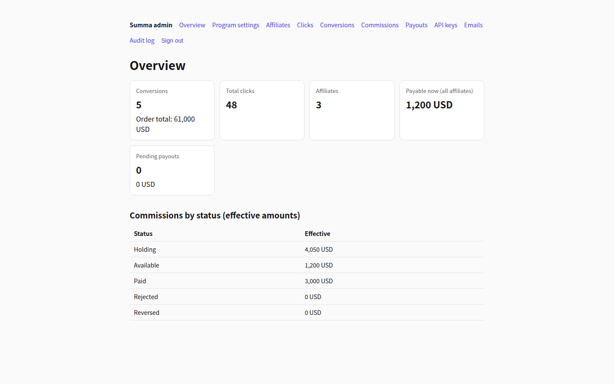
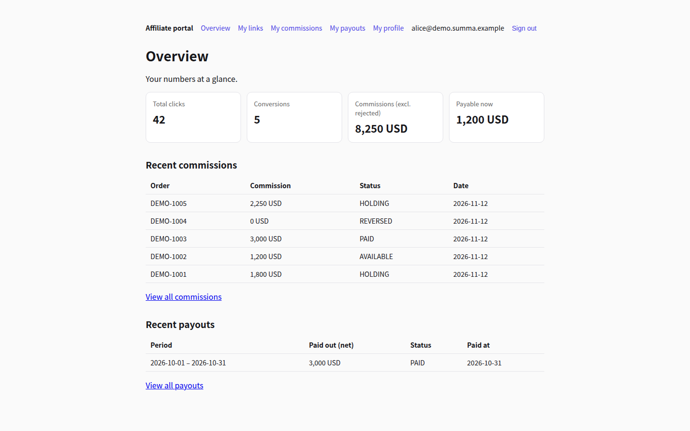
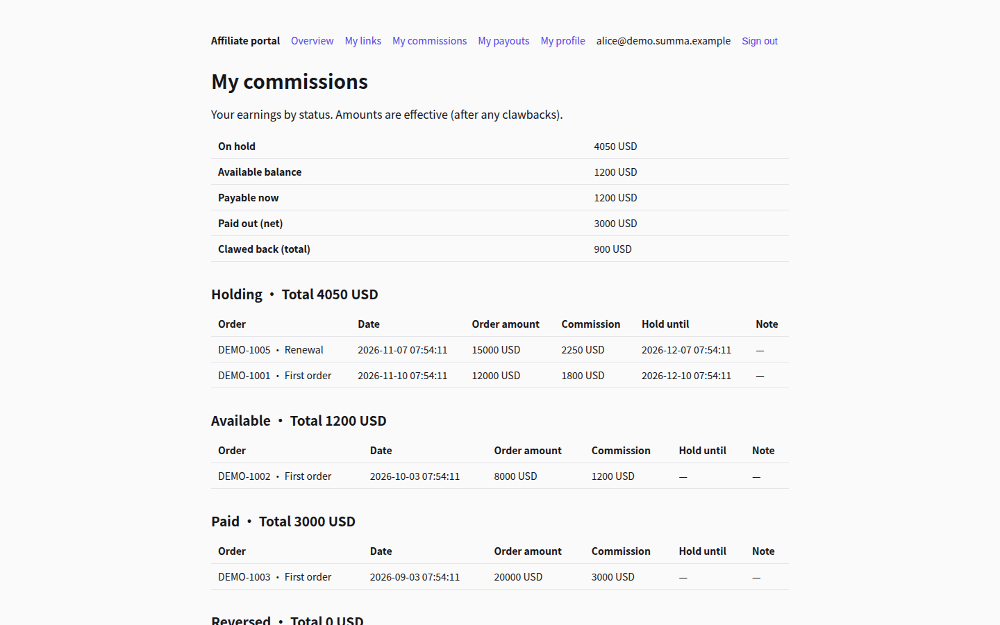

# Summa

**Open-source affiliate marketing platform.** Run your own affiliate program — recruit affiliates, track referrals, compute commissions, and pay out — on your own servers.

*Affiliate marketing, summed up.*



## Features

Everything below is implemented and working in this repository:

- **Programs & affiliates** — one affiliate program per install, with per-program settings: commission rate (basis points, with floor/nearest/ceil rounding), buyer discount, attribution window, commission hold days, minimum payout, payout day of month. Affiliates join by admin invitation (one-time activation links); statuses: pending activation / active / disabled.
- **Dual attribution** — referral links (`/r/:code` records the click, sets a visitor cookie, redirects) and discount codes (created by the admin, owned by one affiliate). Attribution is last-click within the program's window; a discount code wins over the cookie when both are present.
- **Conversion tracking API** — server-to-server `POST /api/v1/conversions` with API-key auth, per-key rate limiting, and strict idempotency (same idempotency key or same order id never double-counts). Unattributed calls are rejected with 422.
- **Stripe adapter** — a webhook endpoint (`POST /api/webhooks/stripe`) with signature verification that normalizes Stripe payment / renewal / refund / chargeback events into the same conversion pipeline.
- **Commission engine** — every conversion creates exactly one commission that starts in *holding* and matures to *available* after the hold period. Admins can review (approve / reject with a reason). Refunds claw commissions back proportionally (cumulative), chargebacks in full — including commissions already paid out, which become a debt netted against future earnings.
- **Payouts** — monthly settlement sweeps each affiliate's available commissions into a payout showing gross / debt offset / net. Admins mark payouts paid (method + external reference required) or failed (commissions return to the available pool). Payout lists and per-payout detail export to CSV for reconciliation.
- **Two portals** — an admin console (overview, program settings, affiliates, clicks, conversions, commissions, payouts, API keys, email log, audit log) and an affiliate portal (overview, links & materials, commissions, payout history, profile & notification preferences).
- **Transactional email** — invite, commission-available, commission-rejected and payout-paid messages. Two transports: `log` (recorded in the database, visible in the admin console — the default) and `smtp` (delivered via your SMTP server).
- **Audit log & API keys** — key operations leave an audit trail; API keys are stored hashed and shown in full only once.
- **7 languages** — the full UI and email templates ship in English, Traditional Chinese, Japanese, Korean, Spanish, Portuguese and French, switchable per user.

## Quick start (Docker)

You need Docker with the Compose plugin. Then:

```bash
git clone https://github.com/figo6260/summa.git
cd summa
cp .env.example .env
# Edit .env: set POSTGRES_PASSWORD and SESSION_SECRET
#   (generate one with: openssl rand -hex 32)
docker compose -f docker-compose.release.yml up -d --build
```

Open <http://localhost:3000/setup> and create the first admin account. The setup page closes itself once an admin exists.

> Evaluating over plain `http://localhost`? Set `SESSION_COOKIE_SECURE=false` in `.env` first — browsers drop Secure cookies on http origins, so sign-in cannot persist otherwise. Keep the default (`true`) behind HTTPS.

The image applies the database schema automatically on first start. Summa v1 uses `prisma db push` for this — there are no migration files yet; the entrypoint runs it idempotently on every boot.

## First run

1. **Create the admin** at `/setup` (see above).
2. **Create your program** under *Admin → Program settings*: name, commission rate, hold days, currency, and the default landing page for referral links.
3. **Invite an affiliate** under *Admin → Affiliates*. The activation link is shown once; with the default `log` mail transport the invite email — including the link — is also recorded under *Admin → Emails*. The affiliate sets a password and is active.
4. **Share links & codes.** Affiliates create referral links in their portal (*My links*). Discount codes are created by the admin and assigned to an affiliate.
5. **Record a conversion.** Create an API key under *Admin → API keys* (shown in full only once), then call the API from your store:

   ```bash
   curl -X POST https://your-install.example.com/api/v1/conversions \
     -H "Authorization: Bearer summa_live_..." \
     -H "Content-Type: application/json" \
     -d '{
       "externalOrderId": "order-10042",
       "amountCents": 12000,
       "currency": "USD",
       "idempotencyKey": "order-10042-paid",
       "discountCode": "DEMOALICE"
     }'
   ```

   Attribute by `discountCode`, or by `visitorToken` — the `summa_vid` cookie value the `/r/:code` redirect set in the buyer's browser (it is also appended to the redirect target URL). A matching commission appears in *holding*.
6. **Release & pay.** When the hold period passes, mature commissions with the release job (below) or the button on the commissions page. Generate a settlement under *Admin → Payouts*, then mark it paid with the transfer method and reference. The affiliate sees the payout in their portal and gets an email.

## Demo data

On a fresh install you can seed a complete demo program — three affiliates (active / pending / disabled), links, a discount code, clicks, conversions, commissions in every state, one paid payout, and email-log entries:

```bash
docker compose -f docker-compose.release.yml exec app npm run seed:demo
```

Demo affiliate sign-in: `alice@demo.summa.example` / `demo-password` at `/affiliate/login`.

The seed refuses to run if the database already contains a non-demo program, and re-running it replaces the previous demo batch. **Delete the demo program before exposing any seeded install to the internet** — the demo credentials are public by design.

## Configuration

All configuration is via environment variables; [`.env.example`](.env.example) documents every variable with required/optional status. The essentials:

| Variable | Required | Purpose |
|---|---|---|
| `POSTGRES_PASSWORD` | yes (compose) | Password of the bundled PostgreSQL container |
| `SESSION_SECRET` | yes | Signs session cookies (≥ 16 chars; `openssl rand -hex 32`) |
| `DATABASE_URL` | host installs | PostgreSQL connection string (the compose file assembles it for you) |
| `APP_BASE_URL` | no | Public URL of the install, used in email links |
| `SESSION_COOKIE_SECURE` | no | Set `false` only for plain-http local evaluation |
| `MAIL_TRANSPORT` | no | `log` (default) or `smtp`, plus `SMTP_*` / `MAIL_FROM` for smtp |
| `STRIPE_WEBHOOK_SECRET` | no | Enables the Stripe webhook endpoint |
| `SUMMA_API_RATE_LIMIT` | no | Conversion API rate limit per key per minute (default 300) |

## Day-2 operations

Run these against the Docker stack (or `npm run …` in a source checkout):

```bash
# Release commissions whose hold period has elapsed (run daily, e.g. cron):
docker compose -f docker-compose.release.yml exec app npm run commissions:release

# Generate monthly settlement payouts (run on your payout day):
docker compose -f docker-compose.release.yml exec app npm run payouts:generate
```

Payout CSV exports live on the payouts pages in the admin console. Email delivery, audit trail and API key management are also in the console — there is nothing else to babysit.

## Development

```bash
docker compose up -d          # PostgreSQL only (docker-compose.yml)
cp .env.example .env          # set DATABASE_URL + SESSION_SECRET
npm ci
npx prisma db push
npm run dev
```

Stack: Next.js (App Router) + TypeScript + Prisma + PostgreSQL. UI strings live in `public/messages/<locale>.json` (English is the source; all locales must carry the same keys — `node scripts/validate-i18n.mjs` checks this). Terminology is locked in [`docs/i18n-glossary.md`](docs/i18n-glossary.md).

## Summa Pro (hosted)

This repository is the open-source core, free to self-host under Apache-2.0. **Summa Pro** is the hosted edition run by the Summa team — the same core, operated for you, plus capabilities that are *not* part of the open-source distribution:

- Paddle billing adapter (the full integration, beyond the core's Stripe adapter)
- Self-serve affiliate registration with one-code-two-uses growth tooling
- Fraud prevention for clicks and conversions
- Automatic payouts (no manual marking)
- White-labeling
- Multiple programs / brands per account

Pro is hosted-only: there is no self-hosted Pro license and the Pro code is not distributed. If you would rather not run servers, Pro is the way to get them.

## Contributing

Issues and pull requests are welcome. Please keep changes focused, include a short description of how you verified the change, and make sure new UI text goes through the i18n dictionaries (English first, same keys in every locale). By contributing you agree that your contributions are licensed under Apache-2.0.

## License

[Apache-2.0](LICENSE).

## Acknowledgments

Summa's feature design was inspired by open-source affiliate marketing tools, in particular [Refferq](https://github.com/refferq/refferq). Summa is an independent implementation, written from scratch; it is not affiliated with, nor endorsed by, the Refferq project.

---




